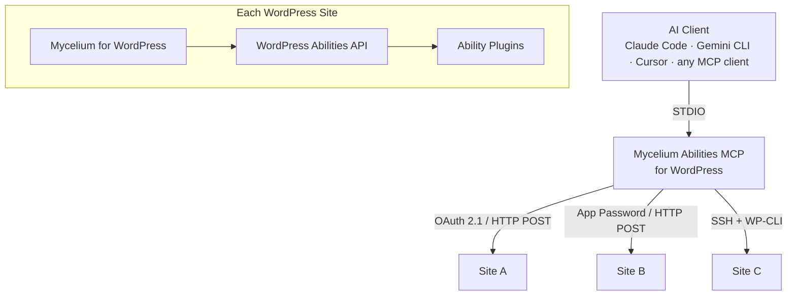

# Mycelium Abilities MCP for WordPress

Mycelium Abilities MCP for WordPress is the local MCP bridge that connects an AI client to one or more WordPress sites. It is the AI-client half of the Mycelium pairing: [Mycelium for WordPress](https://github.com/Wicked-Evolutions/Mycelium-for-WordPress) runs on the site and governs its abilities, while this bridge runs in the AI-client environment and routes calls to them.

The bridge uses the [WordPress Abilities API](https://developer.wordpress.org/reference/functions/wp_register_ability/) and MCP. It supports OAuth 2.1 and Application Password connections, multi-site routing, and a local credential store. The bridge does not give an AI client additional authority: the WordPress user, Mycelium policy, and OAuth scopes determine what it can do.

Some existing client configurations and installation screens still use the short technical label **Abilities MCP**. The package, command, configuration keys, and server identity retain that compatible technical name.

For a new setup, install Mycelium for WordPress on the site, use a dedicated WordPress user with only the needed capabilities, then choose an installation path below for the AI client. Mycelium is a new product currently being prepared for wider public launch. Its repository and release downloads require access until that launch.

## Features

- **Multi-site routing** — Single MCP server serves all your WordPress sites
- **OAuth 2.1** — Dynamic Client Registration, PKCE, browser-loopback consent, keychain-backed tokens, automatic refresh, scope expansion
- **Application Password** — Application Passwords with MCP session management
- **Site parameter injection** — LLM sees a `site` enum on every tool, defaults to your primary site
- **Lazy connections** — Additional non-default sites connect on first use; the primary site connects at startup
- **WordPress multisite** — Subdomain-style multisite with cross-site routing through the dot-suffix model
- **Auto-reconnect** — Exponential backoff, healthcheck pings, session recovery
- **Core bridge** — uses Node.js built-ins; optional keytar provides a native credential-store backend

## What You Can Do

With [Mycelium for WordPress](https://github.com/Wicked-Evolutions/Mycelium-for-WordPress) paired on the site, your AI agent gets the abilities that Mycelium exposes, including:

**Content & Publishing** — content, blocks, patterns, media, menus, taxonomies, comments, revisions
**Site Management** — plugins, themes, settings, users, site health, cache, cron, rewrite rules
**Infrastructure** — filesystem, meta, REST discovery, knowledge layer
**Third-party integrations** — auto-detected modules for supported plugins and themes (Astra, Spectra, SureCart, Presto Player, and more)

Mycelium includes conditional Fluent integrations when the relevant Fluent plugins are installed and active. The bridge can use abilities that the site-side MCP server exposes under its metadata, policy, and permission checks; a WordPress registration alone is not a guarantee of exposure.

Every ability enforces `current_user_can()` at execution time — your WordPress role is the security boundary, with Mycelium policy and OAuth scopes able to narrow access further (see [Notes — Four-layer permissions model](#four-layer-permissions-model)).

> **Paired setup:** use [Mycelium for WordPress](https://github.com/Wicked-Evolutions/Mycelium-for-WordPress) with Mycelium Abilities MCP for WordPress. Earlier standalone products are a migration and compatibility path only; do not install them alongside Mycelium. See [legacy setup notes](https://github.com/Wicked-Evolutions/abilities-mcp/blob/main/docs/legacy-setup.md).

## Install

There are three installation paths. Choose the one that matches the AI client and connection type you use. OAuth through the CLI is the preferred path for a new managed connection; the `.mcpb` bundle is an Application Password baseline and can later be upgraded to OAuth.

### OAuth quickstart for a local desktop client

After the package version you need is published to npm, install the CLI and add the site. This opens the site's OAuth consent flow; it does not need an Application Password.

```bash
npm install -g @wickedevolutions/abilities-mcp
abilities-mcp add-site https://example.com
```

For JSON-based local desktop or development clients, configure the bridge over standard input/output:

```json
{
  "mcpServers": {
    "wordpress": {
      "command": "abilities-mcp"
    }
  }
}
```

The bridge reads the OAuth site configuration it just created. Use the detailed paths below for MCPB, environment-variable, or hand-managed multi-site configuration.

ChatGPT desktop and Codex use their own local configuration; see [Configure Codex for consistency](https://learn.chatgpt.com/guides/best-practices#configure-codex-for-consistency) for the current `~/.codex/config.toml` guidance.

### Set up WordPress

For the paired setup, install and activate [Mycelium for WordPress](https://github.com/Wicked-Evolutions/Mycelium-for-WordPress). It provides the site-side ability and MCP integration used by this bridge.

Create a dedicated WordPress user for AI access.

**In WordPress Admin → Users → Add New:**

| Field | Value |
|-------|-------|
| Username | `mcp-agent` (or any name you prefer) |
| Role | **Administrator** for full access, or **Editor** for content-only access |

**For the `.mcpb` App Password baseline, Path 2, or an App Password entry in Path 3, then generate an Application Password:**

Go to **Users → Edit (your mcp-agent user) → Application Passwords**, enter a name (e.g. "MCP Bridge"), and click **Add New Application Password**. Copy the generated password — it's shown only once.

#### Choosing a role

| Role | Access | Use case |
|------|--------|----------|
| **Administrator** | All modules — content, plugins, themes, settings, users, cache, cron, filesystem, and more | Full site management |
| **Editor** | Content, Blocks, Taxonomies, Patterns, Meta, Media | Content publishing workflows — safe for teams where AI writes but does not configure |

> **Tip:** Start with Editor. Move to Administrator when you need infrastructure abilities like plugin management, theme switching, or settings changes.

OAuth configuration uses the WordPress OAuth consent flow and does not need an additional Application Password.

---

### Path 1 — `.mcpb` bundle for Claude Desktop (Application Password baseline)

Install the `.mcpb` in Claude Desktop with an Application Password. You can then install the CLI and upgrade that connection to OAuth, so tokens live in your operating system's credential store and renew automatically.

#### Step 1 — install the `.mcpb` (Application Password baseline)

1. Download an `abilities-mcp.mcpb` release asset that is available to you from the [releases page](https://github.com/Wicked-Evolutions/abilities-mcp/releases).
2. Double-click the file. Claude Desktop opens an "Install Extension" dialog.
3. Type three things:
   - **WordPress Site URL** — `https://example.com`
   - **WordPress Username** — `mcp-agent`
   - **Application Password** — paste the password from the WordPress setup step
4. Click **Install**. The connection is live with an Application Password.

The bundle covers the single-site case. To unlock OAuth, multi-site, and the `add-site` / `reauth` / `revoke` / `list-sites` / `test` operator flows, continue to Step 2.

#### Step 2 — install the CLI globally for OAuth and multi-site flows

```bash
npm install -g @wickedevolutions/abilities-mcp
```

After the package version you need is published to npm, this puts the `abilities-mcp` command on your PATH so you can run the OAuth subcommands from a terminal.

#### Step 3 — upgrade your Claude Desktop site to OAuth in place

```bash
abilities-mcp upgrade-auth <site>
```

This runs the OAuth 2.1 authorization-code flow with PKCE in your default browser, mints fresh tokens, writes them to your OS keychain, and updates `~/.abilities-mcp/wp-sites.json` so the existing Claude Desktop "Abilities MCP" entry now uses OAuth. The Application Password fallback stays in place until you confirm with `--confirm` in a follow-up `upgrade-auth` run.

#### Step 4 — add additional sites (OAuth by default)

```bash
abilities-mcp add-site https://second-site.com
abilities-mcp add-site https://third-site.com --label="My Staging Site"
```

Each added site provisions OAuth via Dynamic Client Registration, runs the consent flow in your browser, and persists tokens to the keychain. New sites surface through the same Claude Desktop "Abilities MCP" entry — no Claude Desktop config edit needed.

For an Application Password site instead of OAuth, pass `--apppassword --username=<user> --password=<pw>`.

#### Step 5 — expand scopes when broader powers are needed

Default OAuth grants are baseline-scoped — they cover the common read/write categories (`abilities:read`, `abilities:write`, `abilities:multisite:read`, `abilities:multisite:write`). For delete-tier operations, sensitive WordPress core categories (`users`, `settings`, `filesystem`, `plugins`, `cron`, `themes`, `rewrite`), suite scopes (`astra`, `spectra`, `surecart`, `surecart-ecommerce`, `presto-player`), or Fluent suite scopes, extend explicitly:

```bash
abilities-mcp reauth <site> --add-scope="abilities:users:delete abilities:settings:write"
```

The `--add-scope=` flag merges the new scopes into the existing set (deduped, order-preserved). Use `--remove-scope=` to drop scopes by exact match, or `--scope=` to replace the entire set (warns if dropping any). The three flags are mutually exclusive.

**macOS keychain note (since v1.6.0).** On macOS, the bridge uses `/usr/bin/security` as its keychain backend by default under the `auto` backend setting. Every bridge spawn — Claude Desktop, Claude Code, Codex, terminal CLI — issues keychain syscalls through the same caller binary, so macOS's per-binary ACL trusted-application list contains exactly one entry. After your first "Always Allow" the entry reads silently from every runtime. If you upgraded from v1.5.x and Claude Desktop repeatedly asks for keychain access, click **Always Allow** once at the prompt OR run `abilities-mcp add-site --force <site>` / `abilities-mcp reauth <site>` to write a fresh entry under the unified backend.

---

### Path 2 — Env vars (Claude Code, Cursor, Docker, any MCP client)

After the package version you need is published to npm, install the bridge and point your client at it with three environment variables:

```bash
npm install -g @wickedevolutions/abilities-mcp
```

In your client's MCP config:

```json
{
  "mcpServers": {
    "wordpress": {
      "command": "abilities-mcp",
      "env": {
        "ABILITIES_MCP_URL": "https://example.com",
        "ABILITIES_MCP_USERNAME": "mcp-agent",
        "ABILITIES_MCP_PASSWORD": "xxxx xxxx xxxx xxxx xxxx xxxx"
      }
    }
  }
}
```

The endpoint is auto-derived as `<URL>/wp-json/mcp/abilities-mcp-adapter-default-server`. Single-site, Application Password only — for OAuth or multi-site, use Path 1 or Path 3.

For `claude mcp add` users:

```bash
claude mcp add wordpress \
  --env ABILITIES_MCP_URL=https://example.com \
  --env ABILITIES_MCP_USERNAME=mcp-agent \
  --env ABILITIES_MCP_PASSWORD='xxxx xxxx xxxx xxxx xxxx xxxx' \
  -- abilities-mcp
```

---

### Path 3 — `wp-sites.json` (multi-site, power users)

Use this when you want passwords sourced from a keychain or shell command without going through the OAuth provisioning flow, when you're connecting one bridge to multiple WordPress sites with hand-curated config, or when you're targeting WordPress multisite networks with explicit per-subsite entries.

```bash
cp wp-sites.example.json wp-sites.json
```

Edit `wp-sites.json` with your sites, then add the server to your client's MCP config:

```json
{
  "mcpServers": {
    "wordpress": {
      "command": "node",
      "args": ["/path/to/abilities-mcp/abilities-mcp.js"]
    }
  }
}
```

| Client | Config location |
|--------|----------------|
| Claude Code | `.mcp.json` in project root or `~/.claude/.mcp.json` |
| Claude Desktop | `~/Library/Application Support/Claude/claude_desktop_config.json` (or use `--register`) |
| Gemini CLI | `~/.gemini/settings.json` |
| Cursor | `.cursor/mcp.json` in project root |
| Windsurf | `~/.codeium/windsurf/mcp_config.json` |
| VS Code (Copilot) | `.vscode/mcp.json` in project root |

For Claude Desktop, you can also auto-register:

```bash
node abilities-mcp.js --register
```

## CLI Reference

Once `@wickedevolutions/abilities-mcp` is installed globally (or you run `node abilities-mcp.js <subcommand>` from a clone), the following subcommands are available:

| Subcommand | What it does | Common flags |
|------------|--------------|--------------|
| `add-site <url>` | Register a new site (OAuth by default) | `--apppassword` `--username=` `--password=` `--scope=` `--site-id=` `--label=` `--force` |
| `reauth <site_id>` | Re-run the OAuth flow for an existing site | `--add-scope=` (recommended) · `--remove-scope=` · `--scope=` (mutually exclusive) |
| `revoke <site_id>` | Revoke OAuth tokens (local + remote) | — |
| `list-sites` | Show configured sites + auth status | — |
| `test <site_id>` | Ping the adapter and report scopes | — |
| `upgrade-auth <site_id>` | Migrate an existing Application Password site to OAuth in place | `--confirm` (Step 4: drop the App Password fallback after OAuth is verified) |
| `force-downgrade <site_id>` | Override OAuth pinning (escape hatch for capability-pin failure) | `--i-understand-the-risk` (required) · `--reason="<text>"` |
| `self-check <site_id>` | Probe Authorization-header survival end-to-end | — |

Bare `abilities-mcp` (no subcommand) starts the MCP STDIO server — the mode every MCP client config invokes.

### Global flags

| Flag | Description |
|------|-------------|
| `--config=<path>` | Path to `wp-sites.json` |
| `--debug` | Include cause stack on errors; debug logging to `/tmp/abilities-mcp.log` |
| `--allow-insecure` | Allow plain HTTP (localhost dev only) |
| `--register` | Register in Claude Desktop config |
| `--name=<name>` | Server name for `--register` (default: `wordpress`) |

### Exit codes

`0` success · `1` unexpected error · `2` usage error · `3` config error · `4` auth failure · `5` capability-pinning violation

## Configuration

### `wp-sites.json`

```json
{
  "defaultSite": "mysite",
  "sites": {
    "mysite": {
      "label": "My WordPress Site",
      "url": "https://example.com",
      "transport": "http",
      "http": {
        "endpoint": "https://example.com/wp-json/mcp/abilities-mcp-adapter-default-server",
        "username": "mcp-agent",
        "passwordCommand": "security find-generic-password -a mcp-agent -s example.com -w"
      }
    }
  }
}
```

OAuth-managed sites added through `abilities-mcp add-site` are written to `~/.abilities-mcp/wp-sites.json` automatically — they carry an `auth.method: "oauth"` block with keychain references rather than inline secrets.

### OAuth renewal and credential lifetimes

The WordPress OAuth server owns its configured access-token, refresh-token and authorization lifetimes. The expiry metadata on the credential actually issued to a site is the authority; this bridge has no universal duration. A server-policy change applies only when the server issues or renews a credential under that policy—it does not retroactively extend an already-issued token.

Access-token expiry normally triggers automatic renewal while the wider refresh/authorization grant remains valid. The bridge persists the server's returned credential metadata, and `abilities-mcp list-sites` shows the actual recorded expiry information for an OAuth site.

`auth.sliding_renewal` remains a legacy compatibility field. It is not a switch that forces refreshes, persistence, or an extension of a grant; the server's issued metadata and policy remain authoritative.

For a transient connectivity problem, use `wp_bridge_health` and, for a degraded configured OAuth site, `wp_bridge_reconnect`; a network failure alone does not prove that consent or a grant has expired. Fresh OAuth may be needed when the grant is revoked, its refresh or authorization window is exhausted, or a diagnosed terminal credential failure leaves no safe usable pair. An ambiguous rotation state needs diagnosis rather than a blind reset.

### Config search order

1. `--config=/path/to/wp-sites.json` (explicit)
2. `wp-sites.json` in the same directory as `abilities-mcp.js`
3. `~/.abilities-mcp/wp-sites.json`
4. `ABILITIES_MCP_URL` / `ABILITIES_MCP_USERNAME` / `ABILITIES_MCP_PASSWORD` env vars (single-site, used by the `.mcpb` bundle)
5. `--host=<ssh-host> --path=<wp-path>` (legacy SSH single-site)

The first one found wins. If a `wp-sites.json` exists, env vars are ignored.

### WordPress Multisite

For WordPress multisite networks, OAuth multi-site is provisioned through `abilities-mcp add-site --site-id=<subsite-id> https://<subsite-host>` for each subsite you want to operate on. Each subsite provisions its own OAuth token bound to that subsite's resource. Use the explicit subsite IDs in your MCP client.

For App Password multisite (Path 3 hand-curated config), add a `multisite` object mapping subsite slugs to their URLs:

```json
{
  "network": {
    "label": "My Network",
    "transport": "http",
    "http": {
      "endpoint": "https://example.com/wp-json/mcp/abilities-mcp-adapter-default-server",
      "username": "mcp-agent",
      "passwordCommand": "security find-generic-password -a mcp-agent -s example.com -w"
    },
    "multisite": {
      "blog": "https://blog.example.com/",
      "shop": "https://shop.example.com/",
      "example": "https://example.com/"
    }
  }
}
```

Use the dot-suffix routing pattern to target subsites: `"site": "network.blog"`. The bare bridge name (`"site": "network"`) routes to the bridge's own root; the dot suffix routes cross-site through the same adapter. The recommended cross-site context naming uses the network root's domain label (e.g., `wickedevolutions` for `wickedevolutions.com`) — `abilities-mcp add-site` against a Multisite Network root populates this automatically per the dot-suffix model.

### Secure password storage

Three options for providing Application Passwords, from most to least secure:

#### `passwordCommand` (recommended)

Runs a shell command at startup and uses stdout as the password. Works with any OS keychain or secrets manager:

```json
{
  "http": {
    "endpoint": "https://example.com/wp-json/mcp/abilities-mcp-adapter-default-server",
    "username": "mcp-agent",
    "passwordCommand": "security find-generic-password -a mcp-agent -s example.com -w"
  }
}
```

**macOS Keychain** — store the password first, then reference it:

```bash
# Store (one-time)
security add-generic-password -a mcp-agent -s example.com -w 'YOUR_APP_PASSWORD'

# The passwordCommand retrieves it at runtime
"passwordCommand": "security find-generic-password -a mcp-agent -s example.com -w"
```

**Linux (secret-tool / GNOME Keyring):**

```bash
# Store
secret-tool store --label="WP MCP" service example.com user mcp-agent <<< 'YOUR_APP_PASSWORD'

# Config
"passwordCommand": "secret-tool lookup service example.com user mcp-agent"
```

**1Password CLI:**

```bash
"passwordCommand": "op read 'op://Vault/WordPress MCP/password'"
```

#### `passwordEnv`

Reads the password from an environment variable. Useful in CI/CD, Docker, or when you set secrets via `.env` files:

```json
{
  "http": {
    "endpoint": "https://example.com/wp-json/mcp/abilities-mcp-adapter-default-server",
    "username": "mcp-agent",
    "passwordEnv": "WP_MCP_PASSWORD"
  }
}
```

Set the variable before starting the bridge:

```bash
# Shell export
export WP_MCP_PASSWORD="xxxx xxxx xxxx xxxx xxxx xxxx"

# Or in a .env file loaded by your shell/Docker
WP_MCP_PASSWORD=xxxx xxxx xxxx xxxx xxxx xxxx
```

The bridge reads `process.env.WP_MCP_PASSWORD` at connection time. If the variable is not set, it surfaces an error immediately.

#### `password` (not recommended)

Plaintext password directly in the config. Avoid this — config files end up in repos, backups, and logs:

```json
{
  "http": {
    "password": "xxxx xxxx xxxx xxxx xxxx xxxx"
  }
}
```

#### Priority order

If multiple are set: `passwordEnv` → `passwordCommand` → `password`.

## Bridge Tools

The bridge provides four built-in tools (not forwarded to WordPress):

| Tool | Description |
|------|-------------|
| `wp_bridge_health` | Check connectivity status of all configured WordPress sites |
| `wp_bridge_reconnect` | Recover a completed degraded startup for one explicitly named configured site |
| `wp_browse_tools` | List WordPress tool categories with counts (requires `toolFilter.enabled: true`) |
| `wp_load_tools` | Activate/deactivate tool categories for lazy loading |

### Recovering a completed degraded startup

If the bridge started in degraded mode and the site is reachable again, call
`wp_bridge_reconnect` with the exact configured site ID. The bridge reconnects
only that site, privately validates MCP initialization and every page of its
tool catalog, then announces one catalog refresh. It does not contact another
configured site, force a token refresh, reset authorization state, or change
OAuth consent. A healthy bridge cannot use this tool to switch its default
site. Recovery currently supports OAuth-configured sites only; legacy carrier
types are rejected before a connection is attempted. Reauthorize only when the
site reports an authorization failure.

The AI client must refresh its own tool catalog after that announcement. If the
site was unavailable when the client started, reconnect may restore
communication without restoring the tools in that current chat. In the tested
case, the bridge reconnected and reported the site healthy, but the affected
Codex chat still exposed only its four local bridge tools. A fresh ordinary
online connection loaded the full remote catalog successfully. Start the site
before opening the client where possible. Once it is reachable, start a fresh
MCP connection when the client supports that, or restart the client if that is
how it creates a new connection. Reauthorization is not the remedy for this
connectivity problem. This client-catalog boundary remains tracked in
[#125](https://github.com/Wicked-Evolutions/abilities-mcp/issues/125).

## Usage

### Multi-site mode

When multiple sites are configured, every tool gets an optional `site` parameter:

```json
{
  "name": "content-list",
  "arguments": {
    "site": "staging",
    "post_type": "post"
  }
}
```

Omit `site` to use the default site. For multisite networks, the `site` enum surfaces both the bare bridge name and the dot-suffix cross-site contexts (e.g., `network`, `network.blog`, `network.shop`).

## Architecture



- One STDIO process handles all sites through a unified connection pool
- **OAuth 2.1 transport** — Bearer tokens with automatic refresh, keychain-backed persistence, scope expansion via `reauth --add-scope=`
- **Application Password transport** — HTTP Basic with MCP session management, batch coalescing, auto-reconnect
- **SSH transport** — WP-CLI over SSH tunnel, healthcheck pings, handshake replay
- Lazy connections — non-default sites connect on first tool call
- Tool list comes from the default site with `site` enum injected
- Permission metadata (`permission`, `enabled`) flows through annotations to the LLM
- Error responses include `input_schema` for AI self-correction

See [docs/architecture.md](docs/architecture.md) for the full technical deep dive — transport comparison tables, session management, multi-site routing internals, OAuth state machine, and security model.

## Notes

### Four-layer permissions model

When an ability is denied, the first three checks below apply together. Other errors are diagnostic failures, not an additional permission gate:

1. **Mycelium policy** — the paired site setup can narrow an ability's operation before execution. A legacy standalone site instead uses the per-blog read/write/delete toggle in *WP Admin → Abilities for AI → Permissions*; use that alternative only without Mycelium.
2. **WordPress capability** — the WordPress user the bridge authenticates as lacks the relevant capability. WordPress core REST returns `rest_forbidden` / `rest_cannot_*` codes. (Fix by granting the cap to the user, or use a higher-privilege user.)
3. **OAuth scope** — the bridge's OAuth token does not include the scope the ability requires. The adapter returns an `insufficient_scope` rejection. (Fix with `abilities-mcp reauth <site> --add-scope="<scope>"`.)
4. **Unclear error** — a generic 500, timeout, or malformed response is not a permission result. Check server logs.

The three permission checks apply together by design (see [PRINCIPLES.md](PRINCIPLES.md), Principle 5 — *Permissions Stay Layered*). The runtime error tells you which check or diagnostic path needs attention.

### Paired ability classes

The product ships compact-vs-full pairs across the API by design. Pick the pair member that matches the traversal you intend:

- `content-list-structure` (id/title/slug/status/date/link, ~0.5KB/post) ↔ `content-list` (full block markup, ~50–200KB/post). Use `content-list-structure` for bulk discovery; use `content-list` for targeted full inspection.
- `content-get-text` (plain text stripped, ~2–20KB) ↔ `content-get` (full block markup, ~50–200KB). Use `content-get-text` when you want the readable content; use `content-get` when you need the block structure.

Each ability description names its payload tradeoff. The pattern recurs across other categories — read the description before reaching for the heavy member when a compact member is available.

### Multisite OAuth subsite execution

For WordPress multisite networks under OAuth, add each subsite you want to operate on as a separate site entry: `abilities-mcp add-site --site-id=<subsite-id> https://<subsite-host>`. Each subsite provisions its own OAuth token bound to that subsite's resource by the adapter's `mcp_resource` check. Use the explicit subsite IDs in your MCP client. Tracked on [#60](https://github.com/Wicked-Evolutions/abilities-mcp/issues/60) for further iteration.

### Session lock contention ([#4](https://github.com/Wicked-Evolutions/abilities-mcp/issues/4))

Concurrent bridge instances targeting the same site can cause session loss. Use a single bridge process per site.

## Requirements

- Node.js >= 18
- WordPress 6.9+ with [Mycelium for WordPress](https://github.com/Wicked-Evolutions/Mycelium-for-WordPress) for the paired setup
- Existing legacy standalone installations: see [legacy setup notes](https://github.com/Wicked-Evolutions/abilities-mcp/blob/main/docs/legacy-setup.md)
- Application Passwords enabled (default in WordPress 5.6+) only for the App Password bundle/baseline and App Password paths; OAuth uses the site OAuth flow

## MCPB maintainer build

Install the locked development tools before validating or building a bundle:

```bash
npm ci
npm run validate:mcpb
npm run pack:mcpb
npm run verify:pack-isolation
```

Both commands use the repository's pinned local MCPB CLI; they do not download
or substitute a global tool. The pack step preserves the official MCPB archive
and normalizes only its validated ZIP32 DOS timestamps to `1980-01-01`, so
identical inputs produce a reproducible unsigned bundle. It rejects archive
layouts outside the official unsigned single-disk ZIP32 shape rather than
rewriting them. `verify:pack-isolation` additionally proves the temporary
keytar prebuild staging did not alter the installed keytar package.

Reproducibility is for fixed inputs, the pinned toolchain, and one build
platform; the bundle deliberately contains platform-native keytar binaries, so
it is not a claim that independently built artifacts from different platforms
are byte-identical. The exact MCPB `2.1.2` development pin includes two
ancestor-scoped security overrides: Zod `4.6.7` and tmp `0.2.7`. MCPB declares
the former's original Zod 3 range, so pack/validate compatibility is verified
locally before using the override. Revisit and remove these narrow overrides
when upstream MCPB supports patched dependencies directly.

## License

GPL-2.0-or-later
