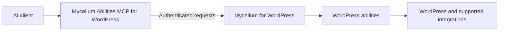

# Mycelium Abilities MCP for WordPress

Mycelium Abilities MCP for WordPress connects your AI client to your WordPress sites.

It works with **[Mycelium for WordPress](https://github.com/Wicked-Evolutions/Mycelium-for-WordPress)** as two parts of one solution:

- **Mycelium for WordPress runs on your site.** It provides abilities and governs access to WordPress.
- **Mycelium Abilities MCP runs in your AI-client environment.** It connects the client to those abilities and routes requests to the selected site.

Use the same bridge to work with one site, several independent sites or supported WordPress multisite configurations.

Mycelium for WordPress is currently in private development. Its repository and release downloads require access until its public launch.

## What you can use it for

Through Mycelium's exposed abilities, your AI client can help with:

- **Content and publishing:** posts, pages, blocks, patterns, media, menus, taxonomies, comments and revisions.
- **Site management:** plugins, themes, settings, users, site health, cache and scheduled tasks.
- **Knowledge and infrastructure:** documents, filesystem operations, metadata and REST discovery.
- **Supported integrations:** conditional abilities for Fluent products and other supported plugins and themes, including Astra, Spectra, SureCart and Presto Player.

The site determines which abilities are exposed. Availability depends on installed integrations, configuration, WordPress capabilities, Mycelium permissions and OAuth scopes.

Registering an ability in WordPress does not, by itself, guarantee that it will be exposed through MCP.

## Features

- **OAuth authentication:** browser consent, PKCE, stored credentials, automatic renewal and explicit scope expansion.
- **Application Password authentication:** an alternative connection method with MCP session management.
- **Multiple sites:** one bridge routes requests to your configured sites.
- **WordPress multisite:** explicit OAuth subsite connections and supported dot-suffix routing.
- **Lazy connections:** additional sites connect when first used; the primary site connects at startup.
- **Connection recovery:** session recovery and an explicit reconnect tool for supported degraded-startup cases.
- **Credential storage:** operating-system credential storage, with an optional native keytar backend.

## Product name and technical identifiers

The outward-facing name is **Mycelium Abilities MCP for WordPress**.

Existing installations and configuration screens may still show **Abilities MCP**. These technical identifiers remain unchanged:

| Item | Identifier |
| --- | --- |
| npm package | `@wickedevolutions/abilities-mcp` |
| CLI command | `abilities-mcp` |
| Entry file | `abilities-mcp.js` |
| Repository | `Wicked-Evolutions/abilities-mcp` |
| Typical client configuration key | `wordpress` |

Existing site IDs, credentials and configuration keys retain their current identities.

## Requirements

- Node.js 18 or later.
- WordPress 6.9 or later with Mycelium for WordPress.
- An AI client that supports a local MCP server.
- A WordPress account with the capabilities needed for the intended work.
- Application Passwords enabled only when using an Application Password connection.

Existing standalone-suite installations can use the separate [legacy compatibility guide](https://github.com/Wicked-Evolutions/abilities-mcp/blob/main/docs/legacy-setup.md).

## Set up WordPress

1. Install and activate Mycelium for WordPress.
2. Choose a WordPress account for AI access.
3. Review Mycelium's abilities, permissions and data-protection settings.
4. Select the connection method below.

A dedicated account makes it easier to understand and manage the access granted to an AI client.

Use the capabilities required for the work. An Editor account may suit content workflows; administration tasks may require additional capabilities. Mycelium permissions and OAuth scopes can restrict access further.

**OAuth does not require an Application Password.**

For an Application Password connection, generate one under **Users → Edit User → Application Passwords**.

## OAuth quickstart

Once the required package version is published to npm, install the CLI:

```bash
npm install -g @wickedevolutions/abilities-mcp
```

Add your site:

```bash
abilities-mcp add-site https://example.com
```

This opens the site's OAuth consent flow and stores the resulting credentials in your operating system's credential store.

Configure your AI client to start the bridge.

For clients using a JSON `mcpServers` configuration:

```json
{
  "mcpServers": {
    "wordpress": {
      "command": "abilities-mcp"
    }
  }
}
```

The bridge reads the site configuration created by `add-site`.

ChatGPT desktop and Codex use their own configuration format. See the [official configuration guidance](https://learn.chatgpt.com/guides/best-practices#configure-codex-for-consistency) for `~/.codex/config.toml`.

## Installation alternatives

### 1. MCPB bundle for Claude Desktop

The `.mcpb` bundle starts with an Application Password connection. You can subsequently upgrade that connection to OAuth.

1. Download the versioned `.mcpb` asset from the [GitHub releases page](https://github.com/Wicked-Evolutions/abilities-mcp/releases).
2. Open the file in Claude Desktop.
3. Enter:
   - Your WordPress site URL.
   - The WordPress username.
   - An Application Password.
4. Complete installation.

To use the OAuth and multi-site CLI commands, install the CLI:

```bash
npm install -g @wickedevolutions/abilities-mcp
```

Upgrade the existing site:

```bash
abilities-mcp upgrade-auth <site>
```

This completes OAuth consent, stores the credentials and updates the site's entry in `~/.abilities-mcp/wp-sites.json`.

The Application Password fallback remains until it is explicitly removed after OAuth verification:

```bash
abilities-mcp upgrade-auth <site> --confirm
```

Add more sites using OAuth:

```bash
abilities-mcp add-site https://second-site.com
abilities-mcp add-site https://third-site.com --label="My Staging Site"
```

For an Application Password site:

```bash
abilities-mcp add-site https://example.com \
  --apppassword \
  --username=<user> \
  --password=<application-password>
```

### 2. Environment-variable configuration

This is a single-site Application Password configuration.

Install the bridge:

```bash
npm install -g @wickedevolutions/abilities-mcp
```

Configure a compatible JSON-based client:

```json
{
  "mcpServers": {
    "wordpress": {
      "command": "abilities-mcp",
      "env": {
        "ABILITIES_MCP_URL": "https://example.com",
        "ABILITIES_MCP_USERNAME": "mcp-agent",
        "ABILITIES_MCP_PASSWORD": "xxxx xxxx xxxx xxxx xxxx xxxx"
      }
    }
  }
}
```

The endpoint is derived as:

```text
<URL>/wp-json/mcp/abilities-mcp-adapter-default-server
```

That endpoint name is retained for compatibility.

For Claude Code:

```bash
claude mcp add wordpress \
  --env ABILITIES_MCP_URL=https://example.com \
  --env ABILITIES_MCP_USERNAME=mcp-agent \
  --env ABILITIES_MCP_PASSWORD='xxxx xxxx xxxx xxxx xxxx xxxx' \
  -- abilities-mcp
```

For OAuth or multiple sites, use the OAuth CLI setup or a site configuration file.

### 3. Configuration file

Use `wp-sites.json` for hand-managed configurations, multiple sites, password commands or explicit multisite routing.

From a source checkout:

```bash
cp wp-sites.example.json wp-sites.json
```

Example:

```json
{
  "defaultSite": "mysite",
  "sites": {
    "mysite": {
      "label": "My WordPress Site",
      "url": "https://example.com",
      "transport": "http",
      "http": {
        "endpoint": "https://example.com/wp-json/mcp/abilities-mcp-adapter-default-server",
        "username": "mcp-agent",
        "passwordCommand": "security find-generic-password -a mcp-agent -s example.com -w"
      }
    }
  }
}
```

For a client that launches a source checkout:

```json
{
  "mcpServers": {
    "wordpress": {
      "command": "node",
      "args": ["/path/to/abilities-mcp/abilities-mcp.js"]
    }
  }
}
```

Use your client's configuration format and executable paths.

| Client | Configuration location |
| --- | --- |
| ChatGPT desktop / Codex | `~/.codex/config.toml` |
| Claude Code | `.mcp.json` in the project or `~/.claude/.mcp.json` |
| Claude Desktop | `~/Library/Application Support/Claude/claude_desktop_config.json` |
| Gemini CLI | `~/.gemini/settings.json` |
| Cursor | `.cursor/mcp.json` |
| Windsurf | `~/.codeium/windsurf/mcp_config.json` |
| VS Code / Copilot | `.vscode/mcp.json` |

Claude Desktop registration is also available from a source checkout:

```bash
node abilities-mcp.js --register
```

## Authorization duration and automatic renewal

Mycelium's WordPress OAuth server controls the access-token lifetime, renewal window and any fixed authorization deadline.

Configure these in:

**WordPress Admin → Mycelium → AI Connections → Authorization policy**

The bridge records the expiry information returned with the actual credential. Changing the site's policy does not retroactively extend an already-issued token.

When renewal remains valid, the bridge can renew access automatically and persist the returned credentials. An access-token expiry does not, by itself, require another browser authorization.

Fresh consent may be needed when access is revoked, the renewal or authorization window ends, broader scopes are requested, or a diagnosed credential failure leaves no safe usable credentials.

A network outage alone does not establish that authorization has expired.

View the recorded site status:

```bash
abilities-mcp list-sites
```

The older `auth.sliding_renewal` field remains for compatibility. It does not independently force renewal, credential persistence or an extension of server authorization.

### Expanding scopes

To request additional permissions:

```bash
abilities-mcp reauth <site> \
  --add-scope="abilities:users:delete abilities:settings:write"
```

Available scope controls:

- `--add-scope=` adds to the existing scope set.
- `--remove-scope=` removes exact scopes.
- `--scope=` replaces the scope set.

These flags are mutually exclusive.

WordPress capabilities and Mycelium policy still apply. Adding an OAuth scope does not grant a WordPress capability the user lacks.

## CLI reference

| Command | Purpose | Common flags |
| --- | --- | --- |
| `add-site <url>` | Add a site using OAuth by default | `--apppassword`, `--username=`, `--password=`, `--scope=`, `--site-id=`, `--label=`, `--force` |
| `reauth <site_id>` | Repeat OAuth consent for an existing site | `--add-scope=`, `--remove-scope=`, `--scope=` |
| `revoke <site_id>` | Revoke OAuth access locally and remotely | — |
| `list-sites` | Show configured sites and authorization status | — |
| `test <site_id>` | Test the connection and report scopes | — |
| `upgrade-auth <site_id>` | Upgrade an Application Password site to OAuth | `--confirm` |
| `force-downgrade <site_id>` | Explicitly override OAuth pinning | `--i-understand-the-risk`, `--reason=` |
| `self-check <site_id>` | Check whether the Authorization header survives the request path | — |

Running `abilities-mcp` without a subcommand starts the MCP server.

### Global flags

| Flag | Purpose |
| --- | --- |
| `--config=<path>` | Use a specific site configuration file |
| `--debug` | Include error causes and debug logging |
| `--allow-insecure` | Allow HTTP for localhost development |
| `--register` | Register with Claude Desktop |
| `--name=<name>` | Registration name; default is `wordpress` |

### Exit codes

| Code | Meaning |
| --- | --- |
| `0` | Success |
| `1` | Unexpected error |
| `2` | Usage error |
| `3` | Configuration error |
| `4` | Authorization failure |
| `5` | Capability-pinning violation |

## Configuration search order

The bridge selects configuration in this order:

1. The explicit `--config=<path>`.
2. `wp-sites.json` beside `abilities-mcp.js`.
3. `~/.abilities-mcp/wp-sites.json`.
4. Application Password environment variables.
5. Legacy SSH arguments: `--host=<ssh-host> --path=<wp-path>`.

The first applicable configuration wins. A configuration file takes precedence over environment-variable setup.

OAuth sites created through `add-site` use credential-store references rather than inline OAuth secrets.

## Working with multiple sites

Each exposed tool can carry a `site` parameter:

```json
{
  "name": "content-list",
  "arguments": {
    "site": "staging",
    "post_type": "post"
  }
}
```

Omitting `site` uses the default site.

### WordPress multisite with OAuth

Add each subsite you want to operate on:

```bash
abilities-mcp add-site \
  --site-id=<subsite-id> \
  https://<subsite-host>
```

Each connection receives an OAuth credential bound to that subsite's resource. Use its explicit site ID when calling tools.

### Application Password multisite routing

A site entry inside the `sites` object of a hand-managed `wp-sites.json` can define subsite URLs:

```json
{
  "network": {
    "label": "My Network",
    "transport": "http",
    "http": {
      "endpoint": "https://example.com/wp-json/mcp/abilities-mcp-adapter-default-server",
      "username": "mcp-agent",
      "passwordCommand": "security find-generic-password -a mcp-agent -s example.com -w"
    },
    "multisite": {
      "blog": "https://blog.example.com/",
      "shop": "https://shop.example.com/"
    }
  }
}
```

Target a subsite using a dot suffix:

```json
{
  "site": "network.blog"
}
```

The bare site name targets the configured root. The dot suffix selects a cross-site context through that connection.

## Application Password storage

### `passwordCommand`

For a legacy v1 `wp-sites.json`, this command supplies the password during one-time migration. The bridge stores that value in the operating-system credential store and replaces the legacy field with a stored-credential reference. Changing the command later does not rotate the imported credential.

Example:

```json
{
  "http": {
    "endpoint": "https://example.com/wp-json/mcp/abilities-mcp-adapter-default-server",
    "username": "mcp-agent",
    "passwordCommand": "security find-generic-password -a mcp-agent -s example.com -w"
  }
}
```

macOS Keychain:

```bash
security add-generic-password \
  -a mcp-agent \
  -s example.com \
  -w 'YOUR_APP_PASSWORD'
```

Linux Secret Service:

```bash
secret-tool store \
  --label="WP MCP" \
  service example.com \
  user mcp-agent <<< 'YOUR_APP_PASSWORD'
```

Corresponding command:

```json
{
  "passwordCommand": "secret-tool lookup service example.com user mcp-agent"
}
```

1Password CLI:

```json
{
  "passwordCommand": "op read 'op://Vault/WordPress MCP/password'"
}
```

### `passwordEnv`

For a legacy v1 `wp-sites.json`, this environment variable supplies the password during one-time migration. The bridge stores that value in the operating-system credential store and replaces the legacy field with a stored-credential reference. Changing the environment variable later does not rotate the imported credential.

```json
{
  "http": {
    "passwordEnv": "WP_MCP_PASSWORD"
  }
}
```

Set the variable in the environment that launches the migration:

```bash
export WP_MCP_PASSWORD="xxxx xxxx xxxx xxxx xxxx xxxx"
```

The migration reads that environment variable once. After migration, the bridge uses the stored-credential reference.

### Inline `password`

For a legacy v1 configuration, a plaintext `password` field is supported, but keeping credentials in configuration files exposes them to copies, backups and accidental sharing.

### Legacy migration behavior

Use exactly one password source per legacy site. On the first bridge start after upgrade, migration resolves one value—inline `password` first, then `passwordEnv`, then `passwordCommand`—stores it in the operating-system credential store, and removes those legacy source fields. Later connections use the stored-credential reference; changing an old environment variable or command does not rotate the imported credential.

### macOS OAuth credential access

Under the automatic backend setting, macOS uses `/usr/bin/security` for credential-store operations.

If macOS prompts for access, the operator may need to approve it. Existing installations upgraded from older keychain backends can require a one-time access decision.

## Bridge tools

| Tool | Purpose |
| --- | --- |
| `wp_bridge_health` | Report connectivity status |
| `wp_bridge_reconnect` | Recover a supported completed degraded startup for an explicitly named OAuth site |
| `wp_browse_tools` | Browse categories in the current direct-tool catalog |
| `wp_load_tools` | Activate/deactivate tool categories for supported lazy tool loading |

`wp_browse_tools` requires `toolFilter.enabled: true`.

### Recovery after an offline startup

If the bridge started while its site was unavailable, restore the site and call:

```text
wp_bridge_reconnect
```

Provide the exact configured site ID.

The bridge validates initialization and the authenticated tool catalog before installing the recovered connection. Recovery uses the existing authorization process; it does not reset consent or force a token refresh.

This recovery command currently supports OAuth sites after completed degraded startup. It does not switch the default site of an already healthy bridge.

**Known limitation:** communication can recover while the current AI chat still lacks the remote tools. The client must refresh its tool catalog. If it does not, start a fresh MCP connection or restart the client after the site is reachable.

Reauthorization is not the remedy for this catalog-refresh problem. See [issue #125](https://github.com/Wicked-Evolutions/abilities-mcp/issues/125).

## How the connection works



One local bridge process manages the configured connections. It routes calls to the selected site and carries the authenticated user's requests to the site-side MCP surface.

The site remains responsible for capability checks, Mycelium permissions and OAuth scope enforcement.

Supported transports include:

- OAuth bearer authentication over HTTP.
- Application Password authentication over HTTP.
- SSH with WP-CLI for supported configurations.

See the [architecture documentation](https://github.com/Wicked-Evolutions/abilities-mcp/blob/main/docs/architecture.md) for implementation details.

## Permissions and troubleshooting

Three permission checks apply together:

1. **WordPress capabilities:** the authenticated user must have the capabilities required by the operation.
2. **Mycelium permissions:** the site can restrict which operations are enabled.
3. **OAuth scopes:** an OAuth connection must include the scopes required for the requested operation.

A generic server error, timeout or malformed response is a diagnostic problem, not a fourth permission grant or gate.

For a denied operation, identify the reported cause before changing access or repeating authorization.

### Prefer compact discovery

Where abilities offer compact and full representations, use the smaller representation for broad discovery.

Examples:

- `content-list-structure` for a content overview; `content-list` when full block markup is needed.
- `content-get-text` for readable text; `content-get` when block structure is needed.

Read the ability description and input schema before execution.

### Session contention

Concurrent bridge instances targeting the same site can encounter session contention. Investigate connection and session behavior before treating the problem as an OAuth expiry.

See [issue #4](https://github.com/Wicked-Evolutions/abilities-mcp/issues/4).

## Earlier standalone products

If you already use the earlier standalone plugins, see the separate [legacy compatibility guide](https://github.com/Wicked-Evolutions/abilities-mcp/blob/main/docs/legacy-setup.md).

For a move to Mycelium, follow [Mycelium's migration guide](https://github.com/Wicked-Evolutions/Mycelium-for-WordPress/blob/main/MIGRATION.md).

## Maintainer build

Install the locked development tools:

```bash
npm ci
```

Validate and build:

```bash
npm run validate:mcpb
npm run pack:mcpb
npm run verify:pack-isolation
```

The build uses the repository's pinned local MCPB CLI. Packaging stages the supported native keytar binaries and verifies that the installed keytar package is unchanged afterwards.

For fixed inputs, the pinned toolchain and one build platform, the unsigned bundle is reproducible. This does not promise identical artifacts from independent builds on different platforms.

The current pinned MCPB toolchain includes narrowly scoped security overrides recorded in `package.json` and `package-lock.json`. Review those pins when updating the build tools.

## License

GPL-2.0-or-later.
